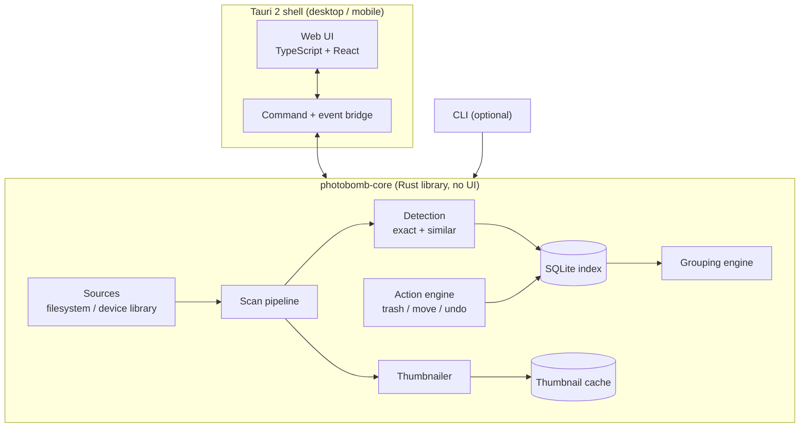

# Architecture

## Overview



- All logic lives in `photobomb-core`. The shell only translates IPC calls and renders.
- The UI holds no source of truth; it queries the core and subscribes to events.
- A CLI on the same crate gives scripting and makes the core testable without a GUI.

## Repository layout

```
crates/
  photobomb-core/     # scanning, hashing, grouping, actions, DB
  photobomb-cli/      # thin CLI over the core
apps/
  desktop/
    src-tauri/        # Tauri shell: commands, events, permissions
    src/              # React UI
design/
```

## Core modules

| Module | Responsibility |
| --- | --- |
| `source` | `PhotoSource` trait: enumerate items, open bytes, trash, move. Implementations: `FsSource` (desktop), later `PhotoKitSource` (iOS), `MediaStoreSource` (Android) |
| `scan` | Walk sources, diff against the index, schedule work, report progress, support cancel/pause |
| `decode` | Decode to a small RGB buffer with EXIF orientation applied; read metadata |
| `hash` | Content hashing (partial + full BLAKE3), perceptual hashing (pHash, dHash) |
| `similar` | Pair search over perceptual hashes, pair storage |
| `group` | Build exact and similar groups; apply similarity level, filters, ignore list |
| `select` | Auto-select rules that propose a keeper per group |
| `action` | Trash / move / hard-link / restore with pre-flight checks and the action journal |
| `thumb` | Generate and cache thumbnails |
| `db` | Schema, migrations, queries |

## Scan pipeline

Stages run as a bounded, cancellable pipeline. Each stage persists its output, so a scan can be interrupted and resumed.

1. **Walk** — enumerate files in each source. Skip by extension, hidden folders and user exclude globs. Record path, size, mtime, file identity (inode / file ID).
2. **Diff** — compare with the index.
   - Unchanged (same path, size, mtime) → reuse all cached hashes.
   - New or changed → queue for processing.
   - Missing → mark as gone (kept briefly so moves can be matched by content hash).
3. **Exact stage** — size bucket → partial hash → full hash (see [detection.md](detection.md)). Only files that still collide advance to the next, more expensive step.
4. **Decode stage** — decode each new photo once at reduced size. From that single decode produce: metadata, perceptual hashes, thumbnail.
5. **Pair stage** — compare new perceptual hashes against all hashes; store pairs within the maximum distance.
6. **Group** — computed on demand from stored hashes and pairs; not a scan stage.

### Concurrency

- IO pool and CPU pool are separate. CPU pool = number of cores (rayon).
- IO concurrency is per device: high for SSD, 1–2 for spinning disks and network shares, to avoid seek thrash.
- Bounded channels between stages give back-pressure and cap memory.
- Database writes are batched through a single writer thread.

### Incremental behaviour

- Rescans touch only new or changed files.
- A renamed or moved file is recognised by size + content hash and keeps its perceptual hashes, thumbnail and ignore decisions.
- Optional filesystem watching (later milestone) feeds the same diff stage.

## Supported formats

| Class | Formats | Notes |
| --- | --- | --- |
| Common | JPEG, PNG, WebP, GIF, BMP, TIFF | Pure-Rust decoders. JPEG decoded with DCT downscaling for speed |
| Modern | HEIC/HEIF, AVIF | libheif (bundled), or the OS codec on mobile |
| RAW | CR2/CR3, NEF, ARW, DNG, RAF, ORF, RW2 | Use the embedded JPEG preview for hashing and thumbnails; no full demosaic |
| Video | MP4, MOV | Exact-duplicate detection only for now. Similarity (keyframe hashes) may be added later and would reuse the pair/threshold machinery |

- A file that fails to decode still takes part in exact-duplicate detection and is listed under "Unreadable".

## IPC surface

Commands (UI → core), all async:

| Command | Purpose |
| --- | --- |
| `sources.list / add / remove / setExcludes` | Manage scanned folders |
| `scan.start / pause / resume / cancel` | Control scanning |
| `groups.query({ kind, similarity, filters, sort, page })` | Paged list of exact or similar groups |
| `groups.get(id)` | Members with metadata and proposed keeper |
| `groups.ignore(id)` / `pairs.ignore(a, b)` | Mark "not duplicates" |
| `select.apply(ruleSet, scope)` | Propose keepers across groups |
| `actions.plan(selection)` | Dry run: what would change, space reclaimed, warnings |
| `actions.execute(planId)` | Perform the plan |
| `actions.undo(journalId)` | Reverse a journaled operation |
| `settings.get / set` | Preferences |

Events (core → UI): `scan.progress`, `scan.stageChanged`, `scan.finished`, `index.changed`, `action.progress`, `action.finished`, `error`.

- Thumbnails and full-size previews are served through a custom URI scheme (`photo://thumb/{id}`, `photo://full/{id}`) so image bytes never pass through JSON.
- Group lists are always paged; the UI virtualises grids.

## Storage locations

| Data | Location |
| --- | --- |
| SQLite index | OS app-data directory (`photobomb/index.db`) |
| Thumbnails | OS cache directory, keyed by content hash |
| Settings | In the index database |

- Nothing is written into the user's photo folders.
- Deleting the cache directory is always safe; thumbnails regenerate.

## Platform notes

### Desktop

- Trash via the OS: Recycle Bin (Windows), Trash (macOS), freedesktop trash (Linux).
- macOS: folder access goes through the system picker; store security-scoped bookmarks to keep access across launches. The Apple Photos library package is treated as read-only and flagged, since deleting inside it corrupts the library.
- Windows: long paths (`\\?\`) and case-insensitive path comparison.
- Network and removable volumes: sources remember their volume identity; an unmounted source is shown as offline, not as "all files deleted".

### Distribution: direct and stores

Both channels ship from the same code; differences are isolated behind build features.

| Concern | Direct download | Store build |
| --- | --- | --- |
| Packaging | Signed/notarised DMG, MSI/NSIS, AppImage + deb/rpm | Mac App Store, Microsoft Store (MSIX), Flatpak (Flathub) / Snap |
| Updates | Built-in updater | Store-managed; updater compiled out |
| File access | Whatever the user account can read | Sandbox: only folders the user picked |
| Network | None | None (no network entitlement requested) |

Sandbox rules the core is designed around:

- Folder access always comes from the system picker (or drag-and-drop), never from a typed path.
- macOS App Store: persist access with security-scoped bookmarks; request the user-selected read/write entitlement.
- Flatpak: folders arrive through the file-chooser portal; trash goes through the trash portal.
- Trash, move and hard-link operations only target paths inside granted sources (plus a picked destination folder).
- If trash is unavailable in a sandbox or on a volume, fall back to "move to folder", never to permanent delete.
- The direct build follows the same picker-based flow, so behaviour is identical and only one path is tested.

### Mobile (later)

- No free filesystem access. Photos come from PhotoKit (iOS) and MediaStore (Android) behind the same `PhotoSource` trait.
- Deletion goes through the system confirmation prompt; the OS "Recently Deleted" album replaces the app's trash.
- iCloud/Google-optimised storage: originals may not be on the device. Perceptual hashing works from the local preview; exact hashing needs the original and is skipped (with a notice) rather than triggering mass downloads.
- Scans must be resumable in short background windows, so every stage is already checkpointed.
- Layout: single-column, swipe-based review instead of the desktop side-by-side view.

## Privacy and security

- No network access; the Tauri capability set omits HTTP entirely.
- The webview can only reach files through the `photo://` scheme, which resolves IDs from the index, never raw paths.
- No analytics. Crash logs stay local and exclude file paths unless the user exports them.
